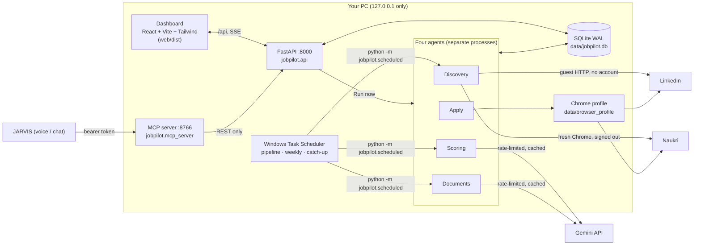
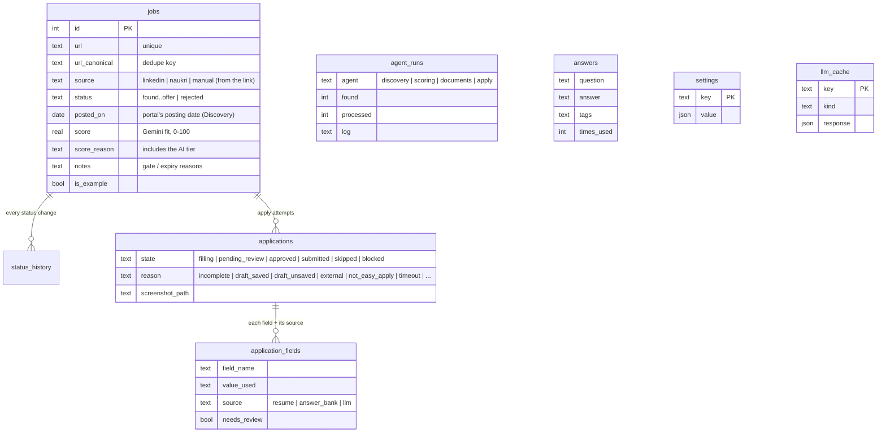

# JobPilot: design

How JobPilot is put together, why, and where its limits are. Updated 25 Oct 2026 to match the code
after it became self-contained (16 Oct). For setup and daily use see the [README](../README.md); for the
build history see [PROGRESS.md](../PROGRESS.md).

## 1. What it is

JobPilot is a local, single-user job-search pipeline with a dashboard:

```
Discovery (LinkedIn, Naukri) -> Scoring (gates + Gemini) -> Documents (tailored resume + cover letter) -> Apply -> track
```

It started as a wrapper around an older agent (`E:\job_search_agent`). On 16 Oct 2026 the parts it still
needed (tailoring, the LinkedIn Easy Apply filler, the Naukri applier, the sign-in helper) were copied in,
and the old search/score/docs agents and the `jobpilot/legacy/` bridge were removed. **Nothing in JobPilot
references the old project any more**; the resume, the application profile and the Chrome profile live
inside `E:\JobPilot`.

Principles:

1. **You stay in control of anything that leaves the PC.** Applications wait for your Approve unless you
   switch on auto-submit, and even then only fully answered, trusted forms go out. Consent boxes, CAPTCHAs,
   OTPs and passwords are always yours.
2. **Gemini judges, code guards.** Cheap rule gates remove what is clearly off-profile; Gemini scores the
   rest; hard caps and fact checks are enforced in code, not only in prompts.
3. **One database, local only.** `data\jobpilot.db` is the single source of truth. The API and the MCP
   server listen on 127.0.0.1 only.

## 2. Architecture



| Layer | Code | Notes |
|---|---|---|
| Config | `jobpilot/config.py` | `.env`: Gemini key/model/RPM, optional `RESUME_PATH`, `APPLICATION_PROFILE_PATH`, `BROWSER_PROFILE_DIR`. Defaults: `config/master_resume.md`, `config/application_profile.yaml`, `data/browser_profile` |
| Database | `jobpilot/db/` + `alembic/` (5 migrations) | SQLModel, WAL, FTS5 on jobs, enum CHECK constraints, UTC stored / IST shown. Runtime knobs in the `settings` table |
| LLM | `jobpilot/llm/` | stdlib Gemini client: token bucket, backoff honouring `retryDelay`, daily-quota fast-fail with fallback models, sha256 cache in `llm_cache` |
| Discovery | `jobpilot/agents/discover.py`, `jobpilot/discovery/` | sources (LinkedIn, Naukri), cards, pre-score, backlog, title variants |
| Scoring | `jobpilot/agents/shortlist.py`, `jobpilot/scoring/` | hard gates, Gemini with AI tiers |
| Documents | `jobpilot/agents/documents.py`, `jobpilot/tailoring/` | truth-first prompt, fact check, date/title checks, ATS `.docx` writer |
| Apply | `jobpilot/agents/apply/` | runner, LinkedIn filler (`easy_apply.py` + `filler.py`), Naukri (`naukri_applier.py` + `naukri.py`), answer bank, sign-in helper, readiness report |
| API | `jobpilot/api/` | data, jobs, applications, runs (+SSE, Run now), answers, settings, schedule, analytics; serves `web/dist` at `/` |
| MCP | `jobpilot/mcp_server/` | 7 tools for JARVIS over the REST API, bearer token |
| Scheduling | `jobpilot/scheduled.py`, `jobpilot/weekly.py`, `scripts/register_tasks.ps1` | three per-user Task Scheduler tasks |
| Dashboard | `web/src/` | Board, Jobs, Review, Runs, Answers, Analytics, Database, Settings; job drawer |

**Why separate processes:** browser automation and long Gemini runs must not block the API. "Run now"
pre-creates the `agent_runs` row and the SSE stream tails the database, so runs started by the scheduler,
the dashboard or JARVIS are all watched the same way.

## 3. Data model



- **Dedupe** by canonical URL (LinkedIn job id, Naukri listing id), checked already at card level during
  Discovery so known jobs are never fetched twice. The portal is read from the link, not a feed label.
- **History:** every status change writes `status_history` with an actor (`agent` or `user`); the
  Analytics funnel is built from it.
- **Settings keys:** `threshold` (60), `daily_apply_cap` (10), `search_queries`, `schedule`,
  `auto_submit` (off), `review_wait_minutes` (20), `weekly_review` (Mon 09:00), `linkedin_easy_apply_only`,
  `park_incomplete` (on), and partial overrides `discovery` and `scoring` edited from the dashboard.
- `agent_runs` keeps the retired names `search`, `score`, `docs` only so old runs still load.

## 4. The four agents

```mermaid
stateDiagram-v2
  [*] --> found: Discovery (card saved; description fetched now or from the backlog)
  found --> rejected: Scoring gate fails, or the posting expired
  found --> shortlisted: Gemini score >= threshold
  found --> found: scored below threshold (kept, never re-scored)
  shortlisted --> docs_ready: Documents (both files written)
  docs_ready --> applied: Apply + your Approve, trusted auto-submit, or "I submitted it"
  applied --> interview: you
  interview --> offer: you
```



### 4.1 Discovery (`python -m jobpilot.agents.discover`)

Per query: **fetch cards -> freshness -> dedupe -> pre-score rank -> enrich the top N -> save as `found`.**

- **Queries** = keywords (Settings search queries) x registered title variants x locations (Hyderabad).
- **LinkedIn** is read through its public, logged-out guest endpoints (10 cards per request, one request per
  enriched posting). No account is used.
- **Naukri** is read in a fresh, signed-out Chrome window (not your profile), paging by clicking Next;
  descriptions open in a second tab.
- **Limits** (defaults, editable in Settings -> Search filters): postings up to 7 days old, up to 120 cards and
  6 pages per query, full descriptions for the top 15 cards per query, then up to 100 more from the backlog.
- **Pre-score** only *ranks* cards for the description budget; it never drops one. Title match to a keyword
  or variant (up to 60), core titles (business/product/systems analyst, product owner, analytics) +15,
  engineering/SAP/sales/HR-type titles -30, AI/GenAI/LLM in the title +10, freshness (up to 20), and
  experience overlapping 3-7 years (up to 10).
- **Backlog:** `found` jobs saved without a usable description are enriched on later runs, freshest first;
  ones past the freshness window are expired (`found -> rejected`, note "Expired: ...").
- A CAPTCHA, login wall, throttle or parse error fails **that query only**, is logged, and is never bypassed.

### 4.2 Scoring (`python -m jobpilot.agents.shortlist`)

1. **Hard gates** (cheap, before Gemini): India only (or bare "Remote"); stated experience must overlap
   3-7 years (unknown or open ranges pass); role family: clearly off-profile titles (manufacturing,
   marketing, finance, customer support, ...) with nothing analyst/product-like fail, and intern, trainee and
   annotation titles always fail. Extra words can be added in Settings. Failures go `found -> rejected`
   with the reason in notes.
2. **Gemini is the only judge** of what passes (`shortlist:v2` prompt, Pydantic-validated JSON, one retry).
   Each job gets an **AI tier**: *core* and *adjacent* (working on AI products or ML-driven analytics) are
   uncapped; *non_ai* is **capped at 65 in code**, so a non-AI role can reach the shortlist but never outranks
   a strong AI role.
3. Score >= threshold (60) -> `shortlisted`; below it the job stays `found` with its score, so it isn't paid
   for twice. Up to 60 Gemini calls per run, best title-relevance first; `--job-ids` re-scores on demand.

### 4.3 Documents (`python -m jobpilot.agents.documents`)

For up to 10 shortlisted jobs without documents (best score first) it writes `output\<Company>_<id>\`:
resume `.docx`, cover letter `.docx`, `match_report.md`.

- **Truth-first prompt + fact check:** any skill, employer, institution or number not in the master resume is
  removed. Every role's dates are forced to the master resume's dates for that company.
- **Titles:** a title must exist in the master resume or be one of the registered alternative titles (each such
  use is noted in the report); otherwise the job is skipped. A job with no real title is skipped.
- **Quality floor:** a cover letter under 2 paragraphs or too few words after the fact check skips the job.
- ATS-friendly Word files (one column, standard fonts, real bullets); Word's 255-char property limit respected.
- `shortlisted -> docs_ready` once both files exist. Raw model output is cached; the checks re-run every time.

### 4.4 Apply (`python -m jobpilot.agents.apply`)

```mermaid
sequenceDiagram
  participant R as apply runner
  participant B as Chrome (data/browser_profile, headed)
  participant DB as jobpilot.db
  participant U as You (Review tab)
  R->>B: open posting (one tab, 20-90 s between jobs, daily cap 10)
  alt CAPTCHA / OTP / checkpoint / login wall
    R->>DB: blocked
    R-->>U: toast; window left open; run stops
  else LinkedIn Easy Apply
    R->>B: fill each step: resume/profile -> answer bank -> Gemini draft (flagged)
    Note over R,B: consent never ticked; stops ON the Submit page
  else Naukri
    R->>B: read only: signed in? external? applied? (Apply IS the submit)
  end
  R->>DB: screenshot + every field with its source
  alt form stuck (missing answer or consent) and park_incomplete on
    R->>B: save LinkedIn's draft (never Discard), close tab
    R->>DB: pending_review, reason draft_saved; blanks listed
    R-->>U: you finish it on the site, then "I submitted it"
  else trusted and auto-submit on and docs_ready and score >= threshold
    R->>B: submit
  else
    R->>DB: pending_review
    R-->>U: toast; Approve / Skip (Approve refused unless the form is on its Submit page)
    R->>B: on Approve: submit (Naukri: untick Follow, Apply, chat answered from the bank only)
  end
  R->>DB: submitted -> job applied
```

- **Trusted** = every field from your resume/profile or the answer bank; nothing empty; no Gemini draft;
  no consent question.
- **Parking** (default on) keeps a run moving: a form that can't reach Submit is filled as far as possible,
  LinkedIn's draft is saved, the blanks are listed in Review, and the agent moves on. A parked job can be
  re-run with `--job-id` (it resumes the draft via LinkedIn's Continue button).
- A closed browser is relaunched and the job retried once; a broken page is skipped as `failed`.
- External ("Apply on company website") and not-Easy-Apply jobs are remembered and never retried.
- **Readiness report** (`python -m jobpilot.agents.apply.readiness`): read-only evidence for switching on
  auto-submit: how many *clean* reviews you decided and what share you approved. It never changes a setting.
- **Sign-in** is yours: `python -m jobpilot.agents.apply.login linkedin|naukri` opens the agent's profile and
  waits while you type the password or OTP.

| Rule | Enforced in |
|---|---|
| Never type a password; use the signed-in profile | `signed_in_browser`, `apply.login` |
| Stop on CAPTCHA / OTP / checkpoint / login wall; never solve | `check_security`, Naukri `_check_security`, "Login to apply" -> `Blocked` |
| No consent or terms on your behalf | `filler.is_consent` + required-checkbox scan; Naukri chat consent check |
| Nothing sent without approval unless trusted auto-submit | `process_job`, `process_naukri_job`, API approve guard, `auto_submit` off by default |
| Gemini never types into Naukri | Naukri chat answers come only from `AnswerBank.lookup` |
| Low cap, random 20-90 s pauses, one tab | `Pacing`, `applied_today`, sequential loop |
| Apply is never scheduled | `scheduled.default_steps` has no apply; Run now and JARVIS run it review-only unless the request says `auto_submit: true` and the setting is ON |

Unknown questions become **open questions** in the answer bank (`needs-answer`); the weekly review asks you
to answer them, which is what lets more applications become trusted over time.

## 5. Running it

| Trigger | What runs |
|---|---|
| Scheduled task **Search-Score-Docs** | Discovery -> Scoring -> Documents. On the chosen days, either every N hours in a window (default 08:00-22:00, every 4 h) or at explicit times |
| Scheduled task **Catch-up** | 2 min after sign-in, unlock or wake: the same pass, only if one is overdue (Windows misses runs during sleep) |
| Scheduled task **Weekly-Answer-Review** | Monday 09:00: toast if open questions are waiting |
| Scheduled task **JobPilot API** | at sign-in: starts the API and dashboard on :8000 (log `data\logs\api.log`) |
| Dashboard **Run now** (`POST /api/runs/pipeline`) | all four agents in order; Apply review-only unless the body says `{"auto_submit": true}` and the setting is ON |
| Dashboard per-agent Run now, CLI | one agent |
| JARVIS via MCP `run_agent` | one agent or the pipeline; Apply review-only unless `auto_submit` is true and the setting is ON |

All scheduled tasks are per-user (interactive logon), ignore a new instance while one runs, stop after 2 h,
and need no admin. A lock file prevents overlapping passes; late starts outside the window (or away from an
explicit time) skip themselves.

## 6. API access and the MCP server (for JARVIS)

**Who may call the API** (`jobpilot/api/security.py`, the outermost middleware). Checks run in this order and the first
failure answers:

| Check | Rule | Refusal |
|---|---|---|
| Client address | loopback only | 403 |
| Host | `127.0.0.1:<port>` or `localhost:<port>`, the port being the one uvicorn is bound to (read from the socket, not configured). `testserver` only when `create_app(test_mode=True)` | 403 |
| Origin (non-GET) | if present, the app's own origin; the Vite origins only with `JOBPILOT_DEV=1` | 403 |
| Auth (non-GET) | `Authorization: Bearer <JOBPILOT_API_TOKEN>` (compared with `hmac.compare_digest`) tags the request `agent`; else `X-JobPilot-Client: dashboard` tags it `dashboard`; neither | 403 |
| Bad bearer | present but wrong, malformed, or token auth disabled; never falls back to the header | 401 |

GET, HEAD and OPTIONS need only the Host check. The dashboard sends the header from its single fetch wrapper
(`web/src/api.ts`). **The header is a CSRF guard, not authentication**: a browser page on another origin can't add it
(that needs a preflight, and CORS allows no foreign origin), but any local program can. The token (32+ characters,
`JOBPILOT_API_TOKEN`) only identifies agents; whether a run may submit is still decided by the run request plus the
auto-submit setting (section 4.4). If the token is missing or short, token auth is off with one logged warning and the
dashboard is unaffected. Runs record `caller`, `auto_submit_requested` and `auto_submit_setting` (nullable columns on
`agent_runs`, migration 0006; CLI and Task Scheduler runs leave them empty). The token is never logged, returned or passed
to agent processes.

**MCP server.** `python -m jobpilot.mcp_server` serves `127.0.0.1:8766/mcp`, protected by `JOBPILOT_MCP_TOKEN`. It has
no database access: every tool calls JobPilot's own REST API, sending `JOBPILOT_API_TOKEN` as a bearer, so the API's
guards apply. It refuses to start without a valid `JOBPILOT_API_TOKEN`.

| Tool | Kind |
|---|---|
| `get_jobs`, `get_shortlist`, `get_review_queue`, `get_run_logs` | read |
| `run_agent` (discovery, scoring, documents, apply, pipeline) | action; apply is review-only unless `auto_submit` is true and the setting is ON |
| `approve_application`, `skip_application` | action, same rules as the Review tab |

Each tool returns `{ok, say, data}`; `say` is short enough for JARVIS to speak.

## 7. Dashboard

Served by the API at http://127.0.0.1:8000 from `web/dist` (React, Vite, Tailwind, TypeScript; Ledger layout,
Flight deck palette; light/dark/system; usable at phone width).

| Screen | Purpose |
|---|---|
| Pipeline rail | stage counts, threshold slider, applied-today meter |
| Board / Jobs | jobs by stage (drag to move) / sortable table |
| Job drawer | scores, AI tier and reason, status, notes, documents, Queue for apply, history |
| Review | each application's fields and sources, screenshot, Approve / Skip / I submitted it; parked drafts and their blanks |
| Runs | Run now (pipeline) and per agent, live logs over SSE, history |
| Answers | answer bank, open questions, weekly review |
| Analytics | stat tiles, funnel, fit-score histogram, applications per day (validated colours, tooltips, table views) |
| Database | table counts, CSV/JSON export, example rows |
| Settings | threshold, cap, auto-submit, parking, review wait, weekly review, Schedule (days, times, register tasks), Search filters (Discovery and gate settings), Gemini status |

## 8. Testing

225 pytest tests. Gemini and Task Scheduler are faked; browsers are real (headless Chrome) against fake pages.

| Area | Covered |
|---|---|
| Discovery | card parsing on real LinkedIn markup, freshness, dedupe, pre-score ranking, backlog and expiry, blocked queries |
| Scoring | gates (India, experience, role family), tiers and the non-AI cap, re-scoring, quota handling |
| Documents | fact check, date correction, titles and registered variants, short cover letters, Word limits |
| Apply | LinkedIn and Naukri on fake pages: no submit while waiting, trusted auto-submit only, consent never ticked, parking and drafts, blocked, external, cap, relaunch; readiness verdicts |
| API, scheduler, MCP | every route and guard; schedule days/times, late runs, catch-up; MCP tools and auth |
| API access | bad Host, Origin, dashboard header and bearer rules over every state-changing route (the list comes from the app, with a guard that it is complete), the token never in logs, responses, run rows or agent environments, MCP bearer and start-up check |
| Self-contained | no import of the old project |
| UI smoke | built dashboard on a temp DB: every screen, move a job, charts, theme, no console errors, no phone overflow |

## 9. Known limits and risks

- **Site terms.** Automating a signed-in LinkedIn or Naukri account (the Apply agent) is against both sites'
  user agreements and can get an account restricted. Discovery runs signed out; the Apply agent's caps and
  pauses reduce the risk; they do not remove it.
- **Markup drift.** Portals change their pages; selectors live in constants, and a broken query or form is
  skipped and logged, never left half-done.
- **Most LinkedIn postings are external.** They still get tailored documents for applying by hand.
- **Gemini free tier** limits throughput, and Google may use free-tier inputs (resume, job descriptions).
- **The PC must be on and you signed in** for anything scheduled; there is no cloud component by design.
