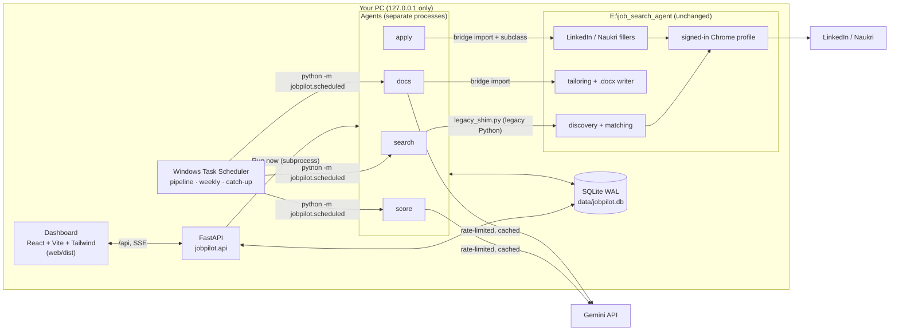
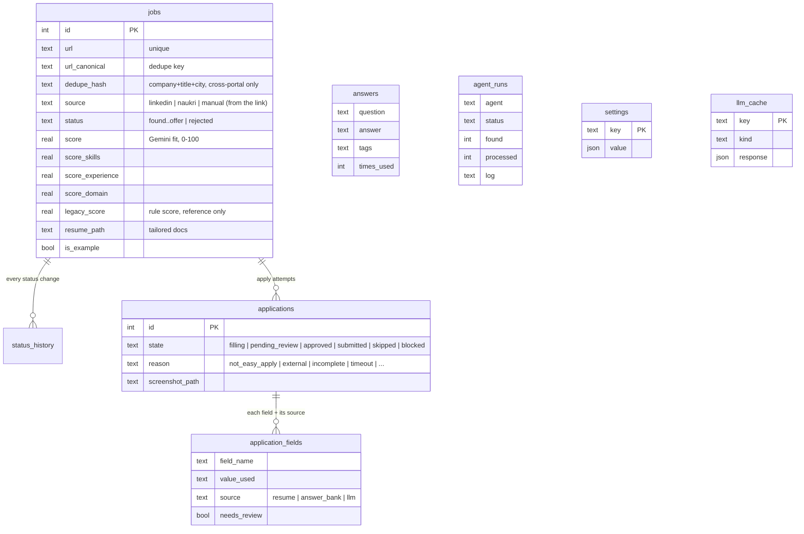
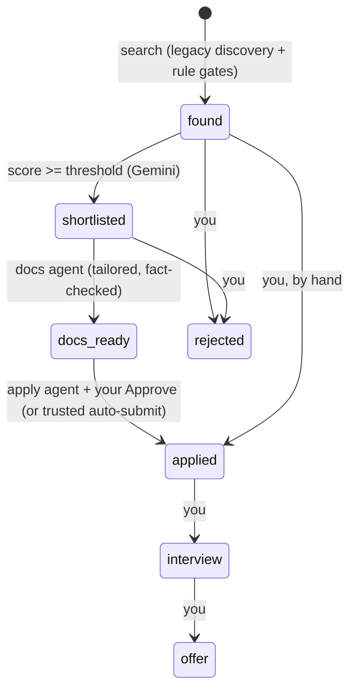

# JobPilot: design

How JobPilot is put together, why, and where its limits are. For setup and daily use see the
[README](../README.md); for the build history see [PROGRESS.md](../PROGRESS.md).

## 1. What it is

JobPilot is a local, single-user system that sits **on top of** an existing Python job agent
(`E:\job_search_agent`, "the legacy agent") and turns it into a supervised pipeline:

```
search (LinkedIn, Naukri) -> score (Gemini) -> tailored resume + cover letter -> apply -> track
```

Three principles shaped every decision:

1. **Wrap, don't rewrite.** The legacy agent already had working Playwright discovery, rule-based
   matching, Gemini tailoring with a fact check, and form fillers. JobPilot reuses that code unchanged
   (imported through a bridge or run through a shim) and adds a database, a dashboard, a new scorer,
   supervision and scheduling. The only edit ever made to the legacy repo is `auto_apply.enabled: false`.
2. **You stay in control of anything that leaves the PC.** Applications wait for your Approve unless you
   switch on auto-submit, and even then only fully answered, trusted forms go out. Consent boxes,
   CAPTCHAs, OTPs and passwords are always yours.
3. **One database, local only.** `data\jobpilot.db` is the single source of truth. The API listens on
   127.0.0.1 and refuses any other client.

## 2. Architecture



| Layer | Code | Notes |
|---|---|---|
| Config | `jobpilot/config.py` | `.env` (secrets, paths) via pydantic-settings. Runtime knobs live in the `settings` table so the dashboard can change them |
| Database | `jobpilot/db/` + `alembic/` | SQLModel models, 3 Alembic migrations, WAL, FTS5 on jobs, enum CHECK constraints, UTC timestamps shown in IST |
| Legacy integration | `jobpilot/legacy/` | `legacy_shim.py` runs under the legacy Python; `bridge.py` imports legacy modules; `importer.py` maps legacy rows |
| LLM | `jobpilot/llm/` | stdlib REST client for Gemini: token bucket, backoff honouring `retryDelay`, daily-quota fast-fail with fallback models, sha256 response cache in `llm_cache` |
| Agents | `jobpilot/agents/` | `search`, `score`, `docs`, `apply/` (runner, LinkedIn filler, Naukri applier, answer bank). Each run is a row in `agent_runs` with a live log |
| API | `jobpilot/api/` | Routers: data, jobs, applications, runs (+SSE), answers, settings, schedule, analytics. Serves `web/dist` at `/` |
| Dashboard | `web/src/` | Views: Board, Jobs, Review, Runs, Answers, Analytics, Database, Settings; job drawer; React Query polling |
| Scheduling | `jobpilot/scheduled.py`, `jobpilot/weekly.py`, `scripts/register_tasks.ps1` | Three per-user Task Scheduler tasks |
| Notifications | `jobpilot/notify.py` | Windows toasts (win11toast); never raises |

### Why these choices

- **Separate processes for agents.** Browser automation and long Gemini runs must not block or crash the
  API. "Run now" pre-creates the `agent_runs` row so the dashboard can stream the log immediately; the
  scheduler's runs land in the same table, so they are watched the same way.
- **SSE that tails the database** instead of piping process output: a run started by Task Scheduler (no
  API involved) is still visible live.
- **Windows Task Scheduler, not APScheduler:** it survives reboots and needs no server running. Because
  Windows does not reliably start missed runs after sleep/modern standby, a catch-up task fires on
  sign-in, unlock and wake and runs a pass only when one is overdue.
- **One server in daily use:** the API serves the built dashboard, so only `run_api.ps1` is needed.

## 3. Data model



- **Dedupe:** canonical URL (LinkedIn job id, Naukri listing id). The company+title+city hash only merges
  jobs across portals, because one company can genuinely post the same title many times.
- **History:** every status change writes `status_history` with an actor (`agent` or `user`), which
  feeds the analytics funnel.
- **Examples:** 15 fictional jobs (plus runs, applications, answers) carry `is_example`, so they can be
  shown, excluded from analytics, or purged in one step.

## 4. The job lifecycle



### Scoring
`score:v3` prompt; Pydantic-validated JSON (overall + skills/experience/domain + reason); one retry on bad
JSON. Domain is judged only from the role's own responsibilities, and roles with no AI component are capped
at 70, because the target is AI Business Analyst / AI Product roles. Cached by prompt version + JD + resume
version, so editing the resume re-scores.

### Documents
The legacy tailoring prompt and fact check run unchanged (unsupported skills and numbers are removed).
JobPilot adds a date/title check against the master resume (dates corrected, unknown titles fail the job),
caps Word properties at 255 chars, and writes `output\<Company>_<id>\` (resume, cover letter, match report).

## 5. Applying

```mermaid
sequenceDiagram
  participant R as apply runner
  participant B as Chrome (agent profile, headed)
  participant DB as jobpilot.db
  participant U as You (Review tab)
  R->>B: open posting (one tab, 20-90 s between jobs, daily cap)
  alt CAPTCHA / OTP / login wall
    R->>DB: application = blocked
    R-->>U: toast, window left open, run stops
  else LinkedIn Easy Apply
    R->>B: fill each step (resume/profile -> answer bank -> Gemini draft, flagged)
    Note over R,B: consent boxes never ticked; stops ON the Submit page
  else Naukri
    R->>B: read only: signed in? external? applied? (Apply IS the submit)
  end
  R->>DB: screenshot + every field with its source
  alt auto-submit on AND trusted AND docs_ready AND score >= threshold
    R->>B: submit
  else
    R->>DB: pending_review
    R-->>U: toast
    U->>DB: Approve / Skip (API refuses Approve if the form isn't on its Submit page)
    R->>B: on Approve: submit (Naukri: untick Follow, Apply, chat answered from the bank only)
  end
  R->>DB: submitted -> job applied (actor: you or agent)
```

**Trusted** means every field came from your resume/profile or the answer bank, nothing is empty, no Gemini
draft, and no consent question. Anything else waits for you. The rules, in one place:

| Rule | Where it is enforced |
|---|---|
| Never type a password; use the already signed-in profile | runner opens the legacy persistent profile; sign-in is done by you with the legacy `login` helpers |
| Stop on CAPTCHA, OTP, checkpoint or login wall; never solve | `check_security`, Naukri `_check_security` and "Login to apply" -> `Blocked` |
| No consent/terms on your behalf | `filler.is_consent` + required-checkbox scan (LinkedIn), chat consent check (Naukri) |
| Nothing sent without approval unless trusted auto-submit | `process_job` / `process_naukri_job`; API approve guard; Settings switch off by default |
| Gemini never types into Naukri | Naukri chat answers come from `AnswerBank.lookup` only |
| Low daily cap, random 20-90 s pauses, one tab | `Pacing`, `applied_today`, sequential loop |
| External / not-Easy-Apply jobs are not retried | `applications.reason` in `NEVER_RETRY` |
| Apply is never scheduled | only search, score and docs are in `jobpilot.scheduled` |

Unknown questions become **open questions** in the answer bank (`needs-answer` tag); the weekly review
(Monday 09:00 IST, toast + dashboard banner) asks you to answer them, which is what lets more applications
become trusted over time.

## 6. Scheduling

| Task | Trigger | Action |
|---|---|---|
| Search-Score-Docs | daily 08:00, every 4 h for 14 h | `pythonw -m jobpilot.scheduled --log` |
| Weekly-Answer-Review | Monday 09:00 | `pythonw -m jobpilot.weekly` |
| Catch-up | 2 min after sign-in, unlock, wake | `pythonw -m jobpilot.scheduled --catch-up` (only if overdue) |

All three: interactive logon (only while you are signed in), ignore a new instance, 2 h limit, no admin.
A lock file prevents overlapping passes and is taken over if stale. A late start more than 30 min after
the window closes skips itself. Times come from the Settings table; the dashboard can register, update and
remove the tasks.

## 7. Dashboard

Ledger layout with the Flight deck palette (chosen from two directions in Phase 5), light/dark/system,
phone-friendly (no sideways scroll at 390 px, checked by the smoke test).

- The **pipeline rail** (stage counts, threshold slider, applied-today meter) sits above every tab.
- **Analytics** follows a validated chart method: one hue for magnitude, emphasis vs a gray for "below
  threshold" (colours validated for colour-blind separation and contrast in both themes), thin marks,
  hairline grids, a tooltip on every mark, and a table view per chart.
- Data is polled with React Query (meta every 5 s, analytics every 30 s); the API log is quiet by default.

## 8. Testing

106 pytest tests (about 2.5 minutes):

| Area | What is proven |
|---|---|
| DB, dedupe, import | migrations build the schema; canonical URLs; idempotent legacy import; portal from the link |
| Scorer, docs | Gemini faked: schema validation, retry, quota handling, cache; fact-check removals, date correction, unknown title |
| API | every route, approve guards, SSE, localhost guard, schedule (PowerShell mocked) |
| Apply (LinkedIn + Naukri) | real legacy fillers on fake pages in headless Chrome: no submit while waiting, approve, auto-submit only when trusted, consent never ticked, unknown question handed over, blocked, external, cap, signed-out portal |
| Scheduler | runs every step after a failure, lock, late-run skip, catch-up decisions |
| UI smoke | built dashboard on the real API with a seeded temp DB: every screen, move a job, chart tooltip/table, theme, no console errors, no overflow at phone width |

Every phase also ended with a real run (real searches, Gemini scoring, generated documents, and live
LinkedIn and Naukri review-mode applications).

## 9. Known limits and risks

- **Site terms.** Automating a signed-in LinkedIn or Naukri account is against both sites' user agreements
  and can get an account restricted. Caps and pauses reduce the risk; they do not remove it.
- **Selectors drift.** LinkedIn and Naukri change their markup. All selectors live in the legacy modules'
  constants; a broken page is skipped (`failed`), never left half-done.
- **Naukri's "Follow company" box** is unticked best-effort (Naukri hides that area from headless browsers,
  so it was tested on a fake page); Review shows what happened.
- **Most LinkedIn postings are external** ("Apply on company website"). Search uses LinkedIn's Easy Apply
  filter; external jobs still get tailored documents for applying by hand.
- **Gemini free tier** limits throughput, and Google may use free-tier inputs (resume, JDs) to improve its products.
- **The PC must be on and signed in** for scheduled runs; there is no cloud component by design.
